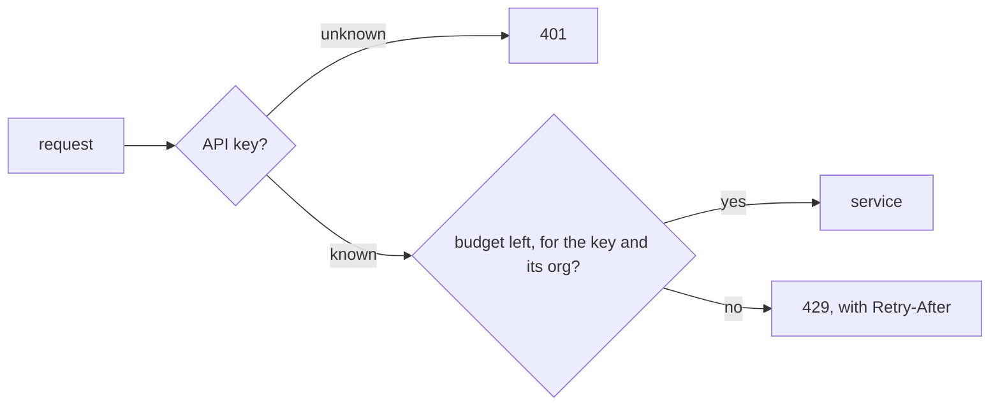

# API Rate Limits

Every API key gets a budget of requests. When a client spends it, the API answers `429` and says when to try again,
so one noisy client can no longer slow the API for everyone else.

## What happens to a request



The gateway checks the budget before any service runs, with one quick call to Redis. When Redis is slow, the request
goes through: a limit never takes the API down.

## Budgets

Each API key, and each organization, has a [token bucket](https://en.wikipedia.org/wiki/Token_bucket): it holds up to
`burst` requests and refills at `rate` a second. A request spends one from both.

```ts
interface Limit { rate: number; burst: number } // per second, bucket size

interface LimitsConfig {
  mode: 'shadow' | 'enforce'; // shadow counts and logs; enforce answers 429
  key: Limit;
  org: Limit;
  overrides: Record<string, Limit>; // an organization's own limit, by org id
}
```

```yaml
# gateway/config/limits.yaml
mode: shadow
key: { rate: 10, burst: 100 }
org: { rate: 50, burst: 500 }
overrides: {}
```

## What clients see

| When | The answer |
|---|---|
| Budget left | as today, with `RateLimit-Remaining` |
| Budget spent | `429`, with `Retry-After` in seconds |
| Redis is slow | as today |

## How it ships

1. **Shadow mode.** Budgets are counted and logged, and no request is refused.
2. **Enforce.** Requests over budget get `429`.

## Not in this change

Limits by IP address or by endpoint, and a dashboard.
